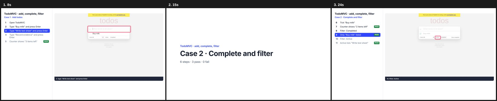

# documented-qa-skill

An agent skill that turns test-sheet cases into **recorded evidence**: Playwright runs with a red box on each element acted on, numbered captions, PASS/FAIL checks, a screenshot per step and a video per run, then one film (made with [HyperFrames](https://hyperframes.heygen.com)) that shows the step list beside each recording. It also covers the delivery: run logs in a PR, a results comment, the video upload and a handoff note.

```bash
npx skills add vincentfranstyo/documented-qa-skill
```

Then ask your agent:

> do documented testing for cases E5 and E6 in this test sheet: <link>

## Example

`templates/example-todomvc.mjs` tests the public [TodoMVC demo](https://demo.playwright.dev/todomvc/) as two cases in one run: add todos, then complete and filter. No accounts or secrets needed. Shortened here; the template adds three todos and checks more.

```js
import { session } from './lib.mjs';

const { page, step, expect, section, close } = await session('T1-todomvc');
const input = page.getByPlaceholder('What needs to be done?');

section('Case 1 · Add todos');
await step('Open TodoMVC', null, () => page.goto('https://demo.playwright.dev/todomvc/'));
await step('Type "Buy milk" and press Enter', input, async (l) => { await l.fill('Buy milk'); await l.press('Enter'); });
await expect('Counter shows "1 item left"', page.getByTestId('todo-count').filter({ hasText: '1 item left' }));

section('Case 2 · Complete and filter');   // new slide in the film
await step('Tick "Buy milk"', page.getByRole('checkbox').last(), (l) => l.check());
await step('Filter: Completed', page.getByRole('link', { name: 'Completed' }), (l) => l.click());
await expect('"Buy milk" listed', page.getByTestId('todo-item').filter({ hasText: 'Buy milk' }));

await close();   // writes raw/T1-todomvc.json + video
```

Run it, then build the film:

```bash
T=skills/documented-qa/templates
mkdir -p qa/scripts && cp $T/lib.mjs $T/package.json $T/example-todomvc.mjs qa/scripts/ && cp -r $T/film qa/film
cd qa/scripts && npm i && npx playwright install chromium
node example-todomvc.mjs                     # → qa/raw/, qa/shots/
cd ../film && node build.mjs "Example · TodoMVC" "T1-todomvc=TodoMVC · add, complete, filter"
npx --yes hyperframes@0.8.186 render -o ../videos/example.mp4
```

The film: step list on the left with the current step lit and PASS chips, recording on the right with a red box on each element acted on. Each `section()` gets its own card and a fresh list; long lists scroll to keep the current step in view.



## Prerequisites

| tool | used for | check |
|---|---|---|
| [Node.js](https://nodejs.org) 18+ | scripts, `npx` | `node -v` |
| Playwright Chromium | recording | `npx playwright install chromium` |
| [ffmpeg](https://ffmpeg.org) (with `ffprobe`) | film cuts | `ffmpeg -version` |
| `jq` | stripping paths from run logs | `jq --version` |
| An agent that supports skills | Claude Code, Codex, Cursor, … | |

## What's inside

- `skills/documented-qa/SKILL.md`: rules and workflow
- `skills/documented-qa/templates/lib.mjs`: the recorder
- `skills/documented-qa/templates/example-login.mjs`: a minimal sign-in run
- `skills/documented-qa/templates/example-todomvc.mjs`: the runnable example above
- `skills/documented-qa/templates/film/`: the film builder

## Safety defaults

It runs against staging only. It asks before creating data, makes one login attempt and then stops, keeps passwords in env vars and masks them in every frame, and keeps videos and screenshots out of git.

## License

MIT
